# Autonomous Navigation in Dynamic GridWorlds with Deep Q-Learning

A from-scratch deep reinforcement learning project for autonomous navigation in a custom **20×20 partially observable GridWorld**. The project explores three environment variants: a randomly placed goal with deterministic patrols, a moving goal, and a moving goal with stochastic enemies.

The experiments use a custom **vanilla Deep Q-Network (DQN)** with a 24-dimensional observation vector and four discrete movement actions. The project includes environment exploration, agent training, policy evaluation, learning curves, recorded episodes, and greedy-policy trajectories.

## Implemented from scratch

The simulator and reinforcement-learning pipeline are custom implementations developed for this project. They include:

- GridWorld transition logic, collision handling, episode termination, and time-limit truncation.
- The 24-dimensional observation encoder and local obstacle-sensing mechanism.
- Potential-based reward shaping.
- Deterministic patrols, moving-goal behavior, and independently moving stochastic enemies.
- The vanilla DQN agent, online and target Q-networks, uniform replay buffer, epsilon-greedy exploration, Bellman updates, training loop, and evaluation utilities.
- Environment rendering, training-history plots, trajectory recording, and GIF generation.

**PyTorch is used for the neural networks and optimization.** The DQN agent, replay buffer, training procedure, and environments are implemented in this project rather than imported from a prebuilt reinforcement-learning library. The environment provides a Gymnasium-style `reset()` / `step()` interface, but the simulator itself is custom-built and does not require Gymnasium.

## Environment variants

### 1. Baseline: Randomized Goal and Deterministic Patrols

The baseline environment uses a fixed maze layout, a fixed start position, and five moving obstacles that follow deterministic six-cell patrol loops. At the beginning of each episode, the goal is sampled from the reachable free cells and remains stationary until the episode ends.

| Property | Setting |
|---|---|
| Grid | 20 × 20 |
| Start | `(0, 0)` |
| Goal | Random reachable free cell at reset; fixed during the episode |
| Fixed walls | 37 cells |
| Moving obstacles | 5 deterministic patrols |
| Patrol movement | One cell per environment step along a six-cell loop |
| Actions | Up, Down, Left, Right |
| Observation size | 24 values |
| Maximum episode length | 180 steps in the reported baseline run |

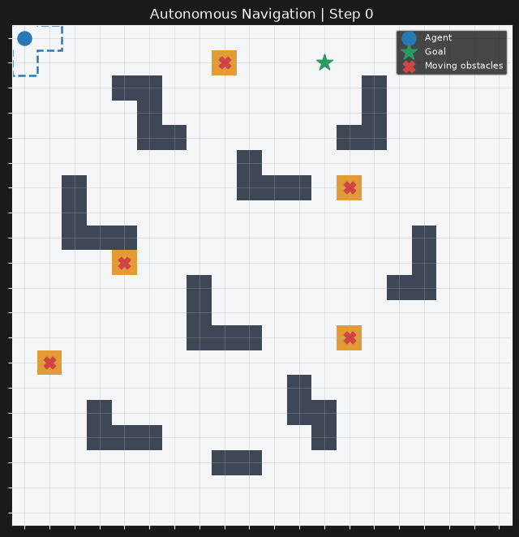

**Notebook 01 — Environment exploration.** This notebook examines the maze layout and the agent's local observation. Although the complete map is shown above, the DQN does **not** receive the full map. Its input contains the agent's coordinates, the globally visible goal coordinates, local obstacle information, and the patrol-phase encoding.

**Notebook 02 — Baseline DQN training**

The following episodes illustrate the trained policy in the baseline environment.

<p align="center">
  
  
  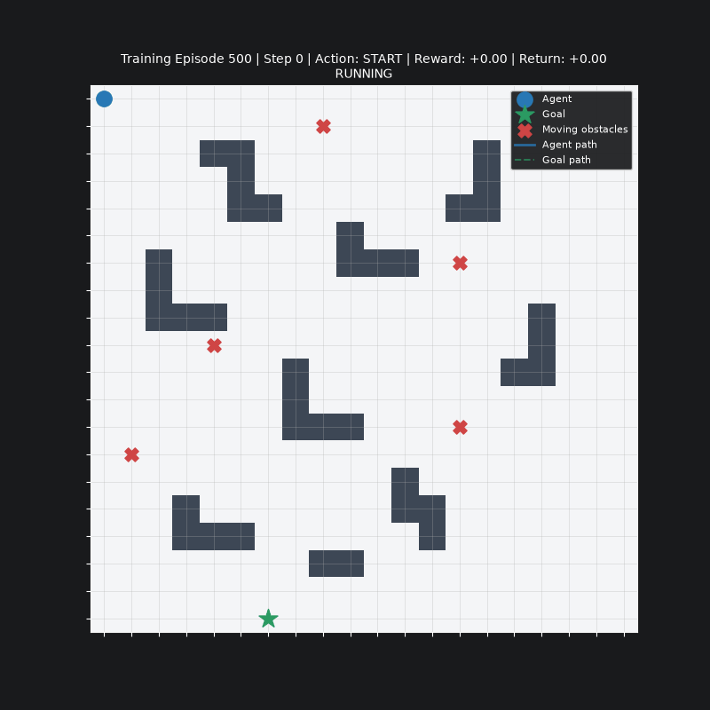
</p>
<p align="center">
  <sub>Episode 1</sub> &nbsp; | &nbsp; <sub>Episode 2</sub> &nbsp; | &nbsp; <sub>Episode 3</sub>
</p>

---

### 2. Moving Goal

The second environment retains the same maze, five deterministic patrols, action space, and 24-dimensional observation. The goal now performs a one-cell random walk to a legal cardinal neighbor every **3 environment steps**.

The DQN architecture and its main hyperparameters remain unchanged. A new DQN is trained for this scenario. The baseline fixed-goal DQN is also evaluated on the moving-goal task without additional training (zero-shot evaluation).

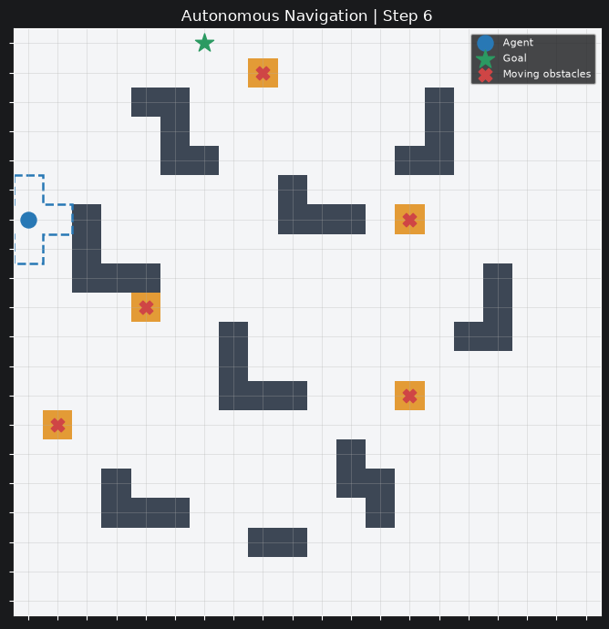

**Notebook 03 — Moving-goal DQN training**

The following episodes show the agent navigating while the goal moves through the environment.

<p align="center">
  
  
  
</p>
<p align="center">
  <sub>Episode 1</sub> &nbsp; | &nbsp; <sub>Episode 2</sub> &nbsp; | &nbsp; <sub>Episode 3</sub>
</p>

---

### 3. Moving Goal with Stochastic Enemies

The third environment retains the moving goal but replaces the five deterministic patrol routes with five independent random-walk enemies.

| Property | Setting |
|---|---|
| Number of enemies | 5 |
| Movement intervals | 1, 2, 3, 4, and 5 steps |
| Speed assignment | Shuffled at every environment reset |
| Pause probability | 0.20 at each movement opportunity |
| Pause duration | Random integer from 1 to 4 steps |
| Goal movement interval | Every 3 environment steps |
| Maximum episode length | 500 steps |

Each enemy chooses a random legal cardinal neighbor when it moves. Enemies do not overlap fixed walls, one another, the agent, or the current goal. A square marker in the environment visualization indicates an enemy that is paused.

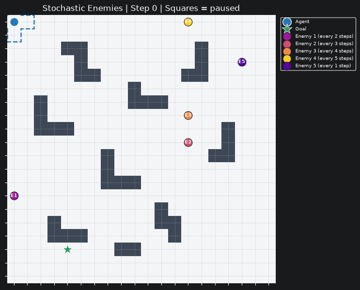

**Notebook 04 — Stochastic-enemy DQN training**

The following episodes show the agent navigating a moving goal while avoiding independently moving enemies.

<p align="center">
  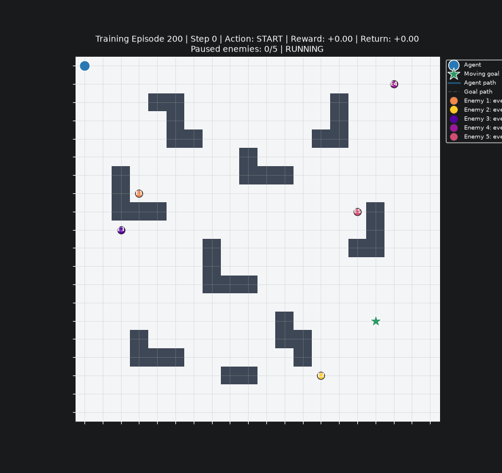
  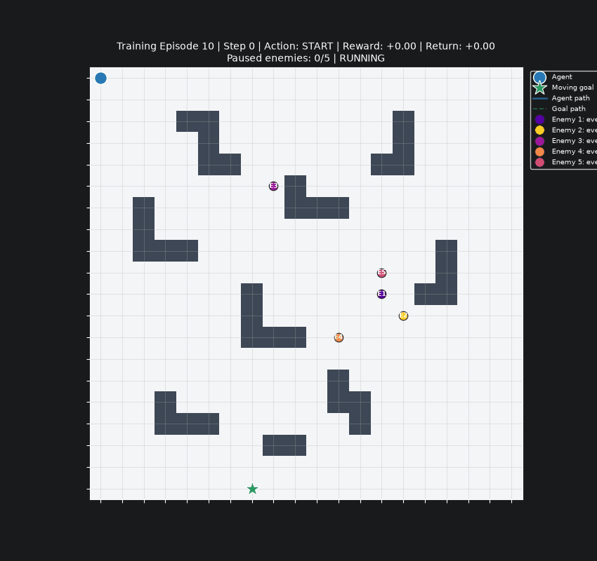
  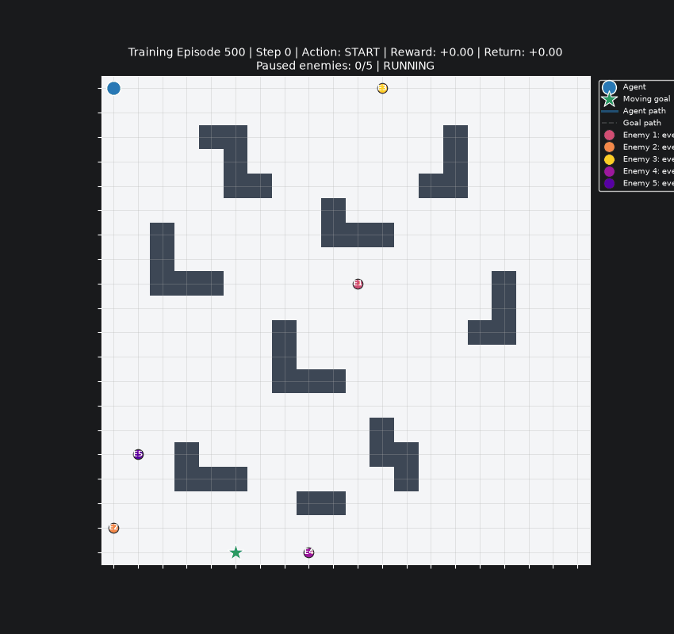
</p>
<p align="center">
  <sub>Episode 1</sub> &nbsp; | &nbsp; <sub>Episode 2</sub> &nbsp; | &nbsp; <sub>Episode 3</sub>
</p>

## Agent observation

The agent receives a **24-dimensional `float32` vector**, not the rendered grid. Its components are:

| Component | Size | Description |
|---|---:|---|
| Agent and goal coordinates | 4 | Normalized agent row/column and visible goal row/column |
| Local fixed-wall encoding | 9 | 3×3 array; only the center and four cardinal neighbors are observable |
| Local moving-obstacle encoding | 9 | Same local encoding for moving obstacles or enemies |
| Patrol phase | 2 | Sine and cosine of the deterministic patrol phase; set to zero in the stochastic-enemy version |
| **Total** | **24** | |

The sensor covers the agent's current cell and its four cardinal neighbors (Manhattan distance ≤ 1). Diagonal cells are not observed and their entries remain zero. The goal is globally visible, while fixed walls and moving obstacles are only locally observable.

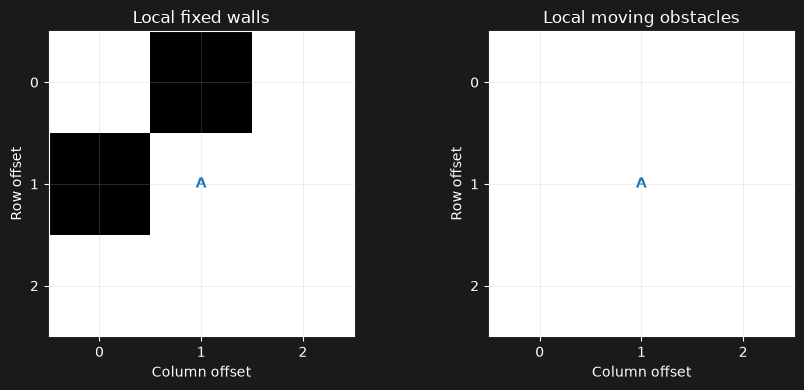

## Rewards

| Event | Reward component |
|---|---:|
| Reach the goal | +20.00 |
| Valid non-terminal move | -0.05 |
| Attempt to enter a wall, obstacle, or invalid cell | Additional -0.75 |
| Potential-based shaping | `γΦ(s') - Φ(s)` |

The potential is based on shortest-path distance through the static free-cell map:

`Φ(s) = -0.5 × distance_to_goal(s)`

The shaping discount is synchronized with the DQN discount factor (`γ = 0.99`). Reaching the goal terminates an episode; reaching the step limit truncates it.

## DQN implementation

The project uses a vanilla feed-forward DQN with an online network and a periodically synchronized target network.

```text
24-dimensional observation
          │
     Linear(24, 256)
          │
         ReLU
          │
    Linear(256, 256)
          │
         ReLU
          │
      Linear(256, 4)
          │
       Q-values
```

### Main training configuration

| Parameter | Value |
|---|---:|
| Learning rate | 0.0001 |
| Discount factor (γ) | 0.99 |
| Replay capacity | 100,000 transitions |
| Batch size | 128 |
| Learning starts | 3,000 environment steps |
| Training frequency | Every 4 environment steps |
| Target-network update | Every 2,000 environment steps |
| Initial ε | 1.00 |
| Final ε | 0.05 |
| ε schedule | Linear over 300,000 environment steps |
| Hidden layers | 2 × 256 units, ReLU |
| Loss | Huber / Smooth L1 |
| Optimizer | Adam |
| Gradient clipping | Maximum norm 10 |

The baseline notebook specifies these values explicitly. The moving-goal and stochastic-enemy notebooks use the corresponding `DQNConfig` defaults.

## Training progress

The plots show the rolling 100-episode mean of task return, success rate, and episode length. Success rate is the main learning diagnostic; return also includes step costs and potential-based shaping.

### Baseline DQN — 3,000 training episodes

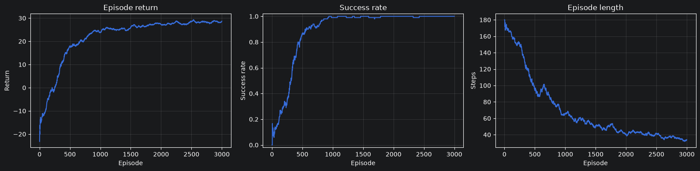

### Moving-goal DQN — 1,000 training episodes

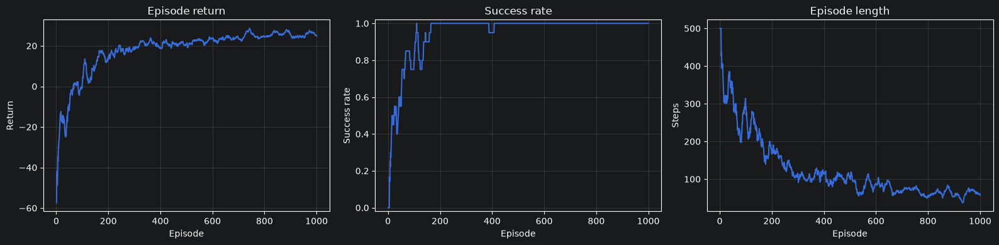

### Stochastic-enemy DQN — 1,000 training episodes

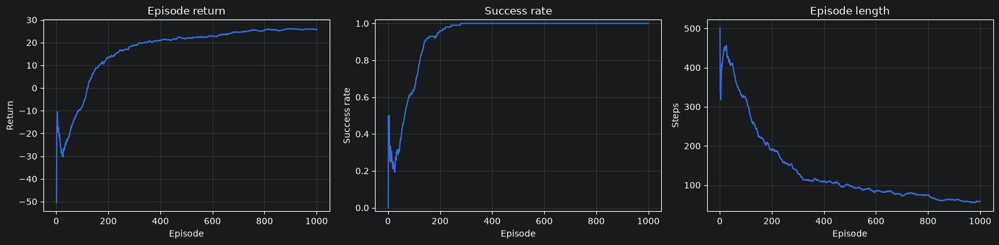

## Evaluation results

All reported evaluations use a greedy policy (`ε = 0`) with learning disabled. Evaluation episodes use fresh environment seeds.

| Scenario / policy | Training episodes | Evaluation episodes | Success rate | Mean return | Mean steps | Blocked-action rate |
|---|---:|---:|---:|---:|---:|---:|
| Baseline: deterministic patrols | 3,000 | 200 | 98.5% | 29.4198 | 21.85 | 0.0% |
| Moving goal: newly trained DQN | 1,000 | 200 | 100.0% | 29.7964 | 21.11 | 0.0% |
| Moving goal: fixed-goal DQN, zero-shot | 3,000* | 200 | 100.0% | 29.7679 | 21.76 | 0.0% |
| Stochastic enemies: newly trained DQN | 1,000 | 200 | 100.0% | 29.4431 | 21.315 | 0.0% |
| Stochastic enemies: independent test | 1,000* | 1,000 | 100.0% | 29.7936 | 22.015 | 0.0% |

`*` The zero-shot moving-goal evaluation uses the baseline model trained for 3,000 episodes. The independent stochastic-enemy test uses the 1,000-episode checkpoint and evaluates it on 1,000 additional episodes with a separate seed (`100000`).

In the independent 1,000-episode stochastic-enemy test, the environment averaged **6.616** goal moves, **33.673** enemy moves, and **20.351** enemy-paused steps per episode.

The episode limits differ across scenarios: 180 steps for the baseline and 500 steps for the moving-goal and stochastic-enemy environments. The results should therefore not be interpreted as a controlled ranking of algorithm performance.

## Example greedy-policy trajectories

These trajectories show the learned policies with exploration disabled. The full map is displayed for visualization; the agent still selects actions from its 24-dimensional observation.

### Baseline environment

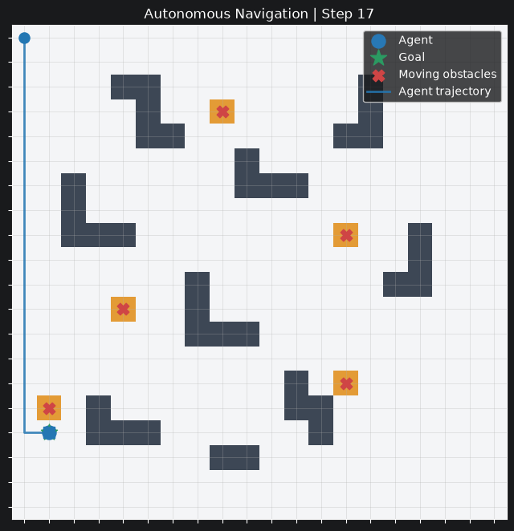

### Stochastic-enemy environment

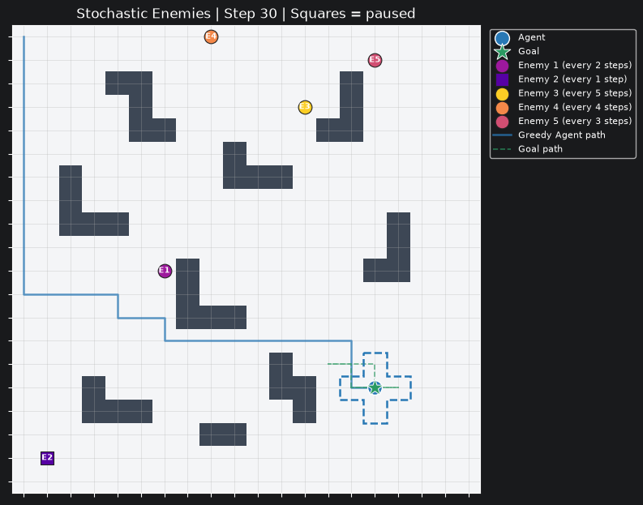

## Repository structure

```text
.
├── README.md
├── pyproject.toml
├── requirements.txt
├── configs/
│   ├── default.yaml
│   └── stochastic_enemies.yaml
├── notebooks/
│   ├── 01_environment_exploration.ipynb
│   ├── 02_dqn_training.ipynb
│   ├── 03_moving_goal_dqn.ipynb
│   └── 04_stochastic_enemies_dqn.ipynb
├── scripts/
│   ├── train.py
│   ├── train_moving_goal_dqn.py
│   └── train_stochastic_enemy_dqn.py
├── src/
│   ├── navigation_rl/
│   ├── moving_goal_dqn/
│   ├── stochastic_enemy_dqn/
│   └── drqn.py
└── assets/
    ├── environment and observation figures
    ├── training curves
    ├── greedy trajectories
    └── training episode GIFs
```

The notebooks use the root-level `pyproject.toml` to locate the project and import the packages under `src/`.

## Installation and usage

Python 3.10 or newer is required.

```bash
python -m venv .venv
```

Activate the environment:

```powershell
# Windows PowerShell
.venv\Scripts\Activate.ps1
```

```bash
# macOS / Linux
source .venv/bin/activate
```

Install dependencies and start Jupyter:

```bash
python -m pip install --upgrade pip
pip install -r requirements.txt
jupyter lab
```

Run the notebooks in order:

1. `01_environment_exploration.ipynb` — inspect the custom environment and observation encoding.
2. `02_dqn_training.ipynb` — train and evaluate the baseline DQN.
3. `03_moving_goal_dqn.ipynb` — train and evaluate the moving-goal variant, including zero-shot evaluation of the baseline model.
4. `04_stochastic_enemies_dqn.ipynb` — train and evaluate the stochastic-enemy variant, then run the independent 1,000-episode test.

A baseline training run can also be started from the repository root with:

```bash
python scripts/train.py --episodes 20000 --seed 42 --eval-episodes 200
```

The notebooks save checkpoints, CSV histories, plots, and episode recordings under their respective result directories. Large checkpoints and generated result folders are best kept outside version control.

## Scope and limitations

- The maze layout, start position, and action space are fixed. The experiments vary goal placement and dynamic-obstacle behavior, but do not demonstrate generalization to unseen maps or arbitrary start positions.
- The goal is globally visible. The agent senses walls and moving obstacles locally rather than receiving a full-map observation.
- The DQN is feed-forward and has no recurrent memory. In the stochastic-enemy setting, the agent does not receive each enemy's speed interval or pause state directly. It must infer enemy behavior from local observations, but the policy has no explicit observation history.
- Each reported training run uses a single training seed (`42`). Multiple independent training runs would be needed to make statistical claims about performance or robustness.
#   D y n a m i c - G r i d W o r l d - D Q N 
 
 "# Dynamic-GridWorld-DQN" 
